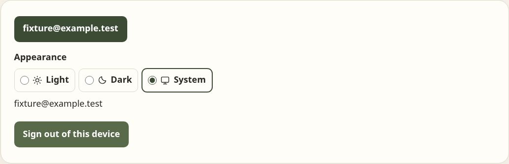
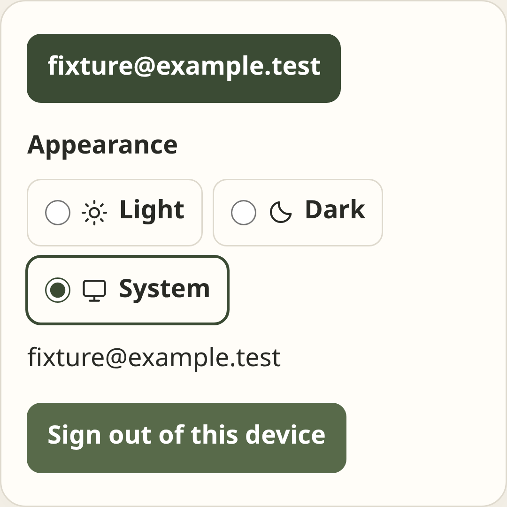
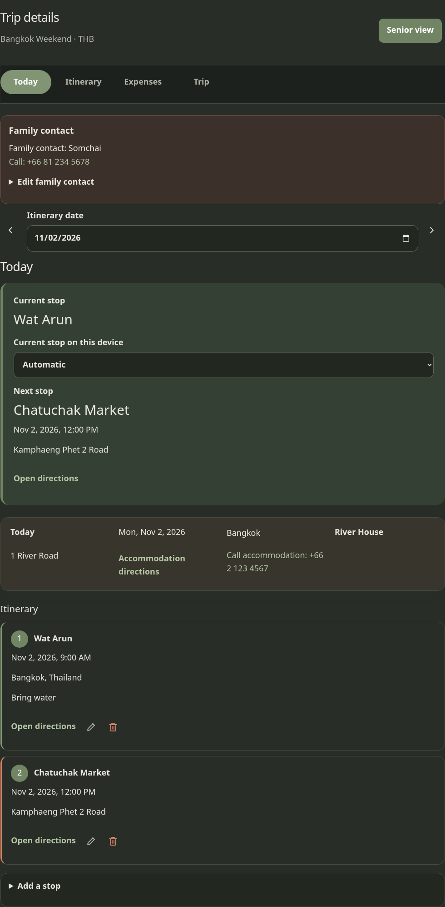
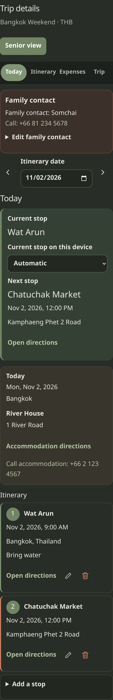
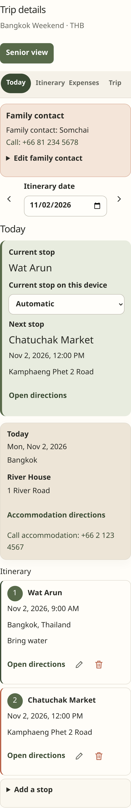

# Browser previews and verification notes

Install the browser once with `npx playwright install chromium`, then run `npm run test:e2e`. Playwright launches local Vite and runs the same mocked trip flows in desktop and mobile Chromium. The fixture provides seeded email and guest sessions plus a sample Bangkok trip through intercepted Supabase REST/RPC calls. It verifies explicit one-trip selection, trip creation, a three-night destination range and middle-night correction, accommodation and daily activities, whole-unit expense splits and correction, Trip-tab management and title-confirmed deletion, safe account sign-out, persisted Senior view, and offline expense queue replay including retry with the same operation ID. Participant and Senior flows assert that check-in and attendance controls are absent and no `check_ins` query or `check_in` RPC is made. A fixed Bangkok clock and sample stops from both the previous and current trip day make Today behavior reproducible.

These screenshots are fixture-backed previews. They show the UI at desktop and mobile viewports; they do not represent a hosted Supabase session, live trip, or real user data.

## Dashboard

## Today

## Plan

## Expenses

## Trip

## Dark and light themes

The theme checks verify that the selected light or dark mode is applied before the page renders, persists in `paikan-theme` after reload, and that a browser with no saved preference follows system light/dark changes live. The fixture uses a fresh context for system preference checks, so it does not clear or replace the primary context's saved theme. Both viewport projects capture Today, Plan, Expenses, and Trip in dark mode, plus a light Today preview. Each capture checks the document width against the viewport to catch horizontal overflow.

The signed-in account menu includes an Appearance radio group with Light, Dark, and System choices. Browser coverage verifies the selected radio, persistence of explicit Dark, and live OS changes after returning to System. Desktop and mobile fixtures capture the open account menu:

The matching dark Plan, Expenses, and Trip previews use the same `desktop-chromium-dark-<tab>-fixture-preview.png` and `mobile-chromium-dark-<tab>-fixture-preview.png` naming pattern in `artifacts/`.

The focused theme and preview tests passed in desktop and mobile Chromium, and the trip Plan itinerary/accommodation editor smoke flow passed in both projects. The previews were visually checked for readable text against the page and card backgrounds; viewport-width assertions passed for every captured tab.

## Senior view

## Offline expense queue

## Activity editor examples

## Plan editors and destination activity time

The Plan regressions check that add and edit forms scroll into view, that selecting another night while editing keeps the form usable, and that editing a closed accommodation form saves the same stay ID with its next version. The mobile editor preview shows the saved fields and both actions within the compact layout. The [compact mobile Plan preview](../artifacts/mobile-chromium-plan-fixture-preview.png) shows the tab layout.

The refreshed Plan previews show destination nights, activities, and stays as flat rows instead of stacked cards. Plan row actions are SVG-only buttons with accessible names and matching titles. The visible Plan, Today, and header UI omits the trip timezone label while date and time entry still uses the destination timezone.

Destination-time regressions run with an America/Los_Angeles browser and an Asia/Bangkok trip. They verify that 09:30 in Bangkok saves as 02:30Z and displays and edits as 09:30 in both Today and Plan, regardless of the browser timezone. A legacy Nov 2 02:00Z activity stays on Nov 2 at 09:00 Bangkok time after an unchanged save. Trip creation saves its IANA timezone, and changing it updates display/edit values while preserving the stored timestamp. Plan regressions check that row action buttons contain SVG icons with no visible text while retaining accessible Edit and Remove names. The preview test also checks that Today, Plan, Expenses, and Trip have no horizontal overflow at both viewport sizes.

The existing focused desktop/mobile verification passed 10/10 cases: account Appearance (2), dark tab previews (2), enrolled itinerary and expense actions (2), Plan editors (2), and trip creation/archive/deletion (2). The account test checks the default System selection, explicit Dark persistence, and live system changes after returning to System. One earlier combined focused run had a transient mobile timeout in the dark tab capture; the identical test passed on isolated retry. For Issue 23, the offline expense, main trip, Senior view, and Today preview checks passed 10/10 desktop/mobile cases; after adding explicit directions and itinerary assertions, the affected main trip and Senior checks passed 4/4. The full desktop/mobile suite has not been rerun.

## Remaining release verification

The browser fixture does not exercise deployed Supabase Auth or Edge Function networking, rate limiting through the production proxy, real organizer-assisted recovery, multiple real browser profiles, browser storage loss, or installed PWA behavior. Before release, repeat the README manual acceptance steps against a configured Supabase project and test installation, offline recovery, and persisted sessions on physical iOS and Android devices.

## US24–US25 daily overviews

Plan displays each day's city, hotel and activities. Accommodation is an alternate Plan view with the same version-checked stay editor. Today supports a bounded itinerary date and previous/next controls, with selected-day city/stay, full activity list, free days and next planned date. Senior view retains the complete selected-day itinerary without editing controls.

New regressions cover daily/Accommodation editing using the same stay ID and successive versions, check-in-inclusive/check-out-exclusive coverage, first/last default dates outside the trip, participant read-only access, and selected-day city/hotel/activity alignment. Fixture-only extended destinations/stays support adjacent-night transitions without changing the baseline fixture used for older flows.

[Mobile daily overview](../artifacts/mobile-chromium-plan-fixture-preview.png), [mobile Today](../artifacts/mobile-chromium-today-fixture-preview.png), [mobile Accommodation](../artifacts/mobile-chromium-accommodation-fixture-preview.png), and [dark daily overview](../artifacts/mobile-chromium-dark-plan-fixture-preview.png) are deterministic sample previews, not hosted traveler data.

Final US24–US25 verification: lint and production build pass; twelve focused component/domain tests pass. The full browser suite completed with 37 of 38 passing; the mobile editor navigation case exposed competing smooth-scroll navigation during view switching. Editor navigation was changed to an immediate scroll. All twelve affected desktop/mobile editor and daily-overview cases then passed. The full 38-case suite was not repeated after that focused fix. Refreshed light/dark Today, daily Plan and Accommodation screenshots were inspected; the mobile Plan view choices fit on one row.

## PWA update regression and live-origin investigation

The live `roam.greatng.me` bundle contained US25 date controls. All ten daily-overview browser cases passed against its deployed JavaScript with fixture-only intercepted API responses and service workers blocked. No real traveler data or authentication was changed.

A separate production-build reproduction confirmed that the old app could have a newer waiting worker with no update action. `npm run test:pwa` now verifies update detection, reopening while an update waits, user-triggered activation/reload, and preservation of a local storage marker and a synthetic queued expense. It does not clear user storage or force an update during editing. The captured prompt is [PWA update preview](../artifacts/pwa-update-fixture-preview.png). The user's private cached client state remains unverified.
