# Browser previews and verification notes

Install the browser once with `npx playwright install chromium`, then run `npm run test:e2e`. Playwright launches local Vite and runs the same mocked trip flows in desktop and mobile Chromium. The fixture provides seeded email and guest sessions plus a sample Bangkok trip through intercepted Supabase REST/RPC calls. It verifies explicit one-trip selection, trip creation, a three-night destination range and middle-night correction, accommodation and daily activities, whole-unit expense splits and correction, Trip-tab management and title-confirmed deletion, safe account sign-out, persisted Senior view, and an offline queue item that fails once and succeeds on retry with the same operation ID. A fixed Bangkok clock and sample stops from both the previous and current trip day make Today behavior reproducible.

These screenshots are fixture-backed previews. They show the UI at desktop and mobile viewports; they do not represent a hosted Supabase session, live trip, or real user data.

## Dashboard

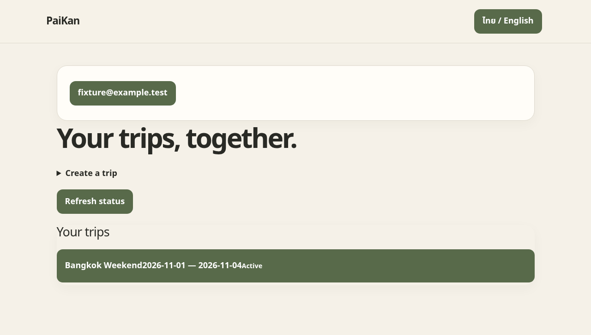

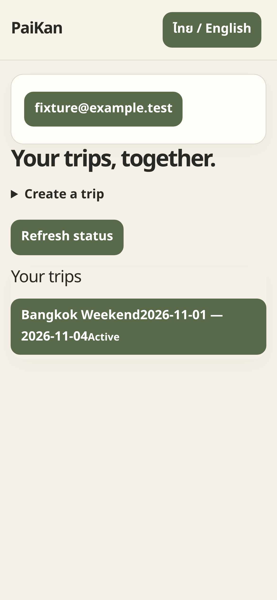

## Today

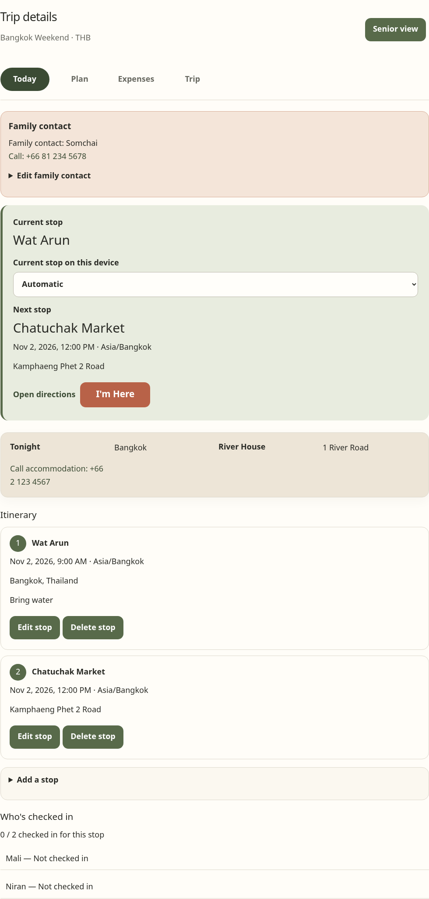

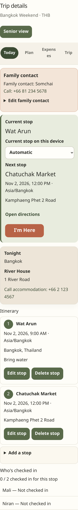

## Plan

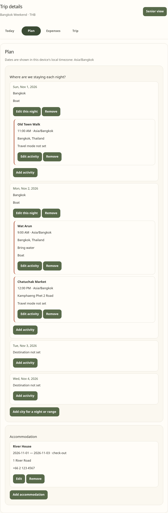

## Expenses

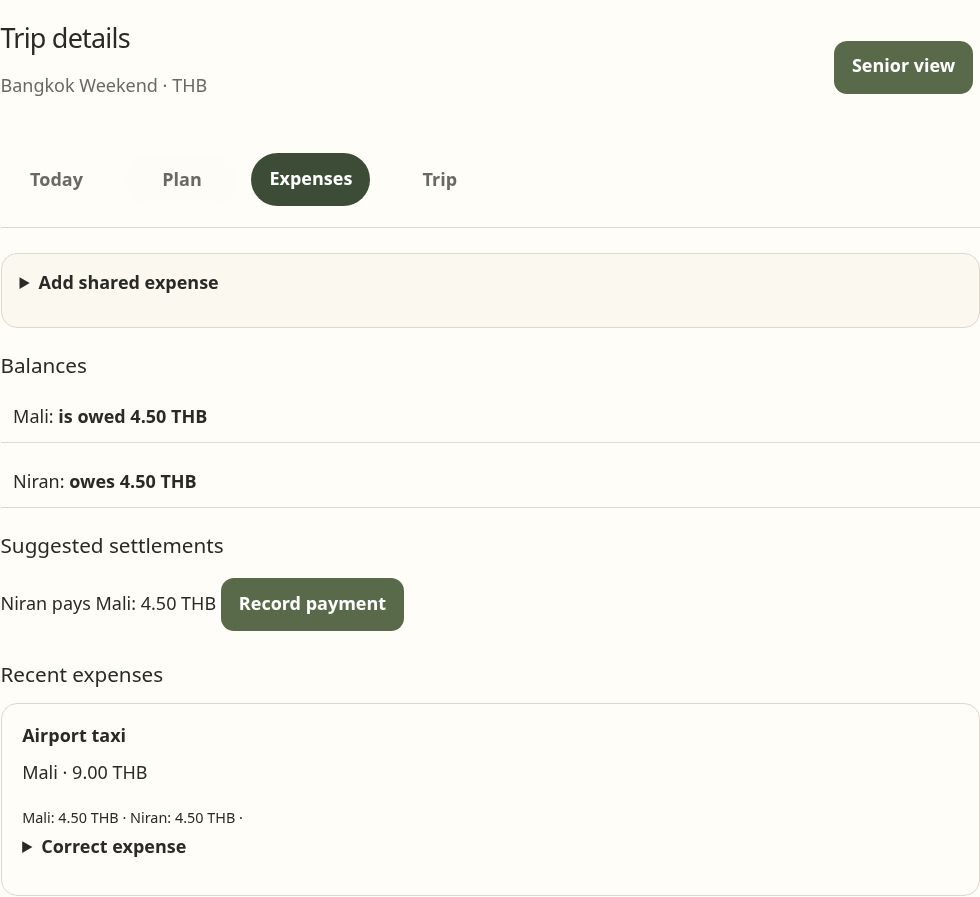

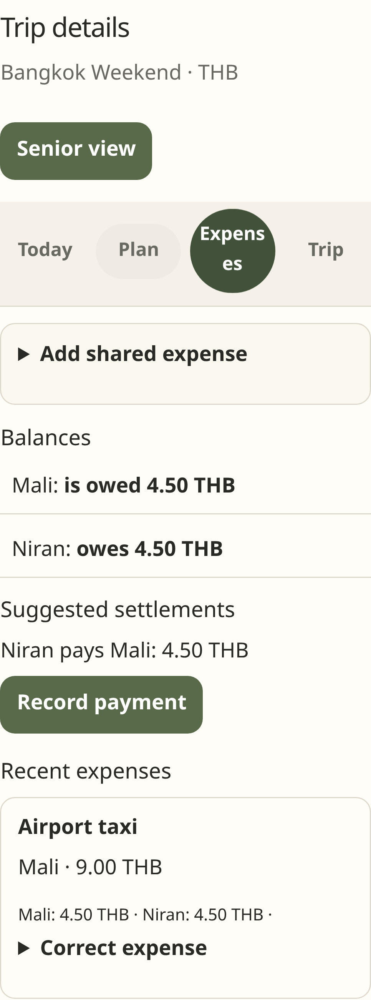

## Trip

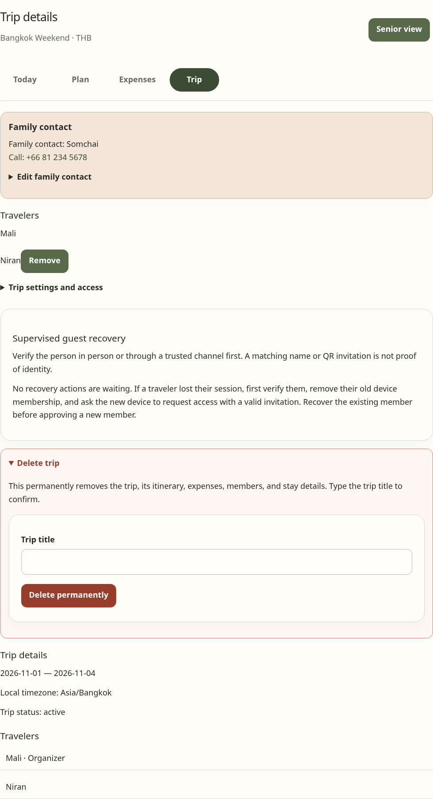

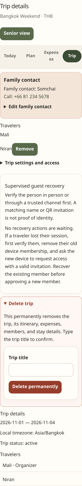

## Senior view

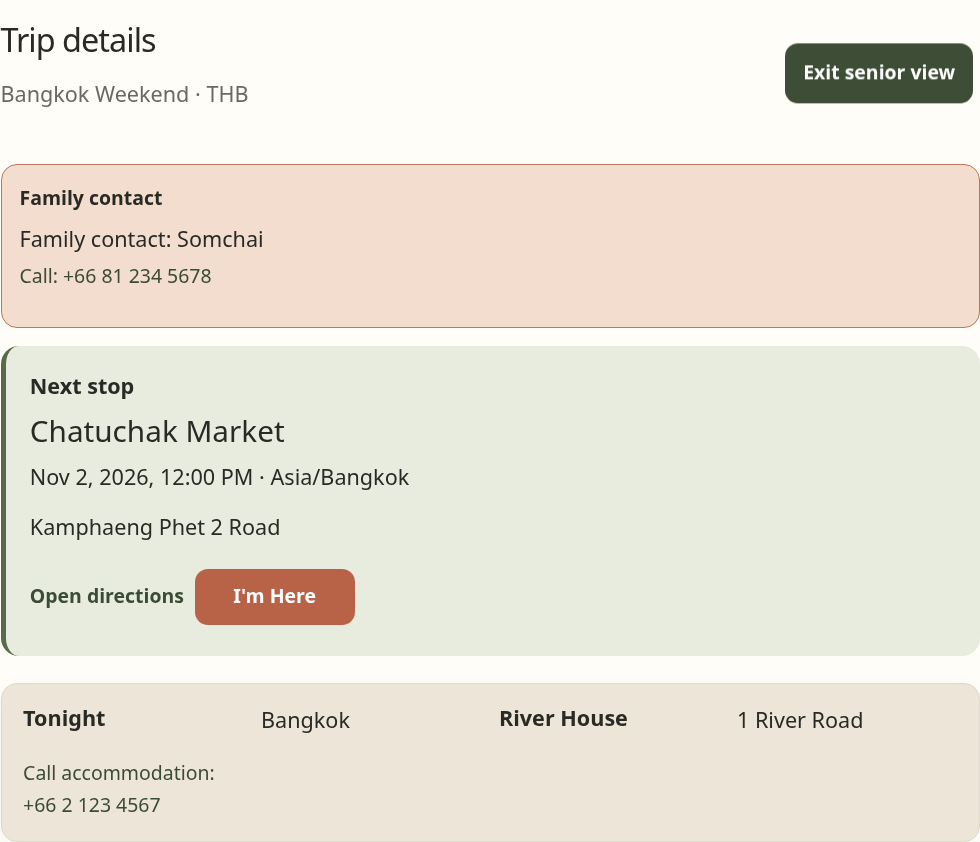

## Offline queue

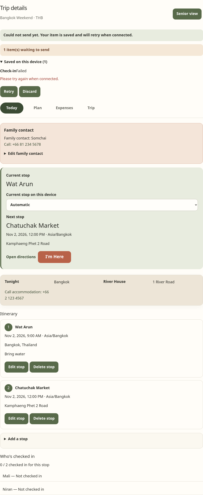

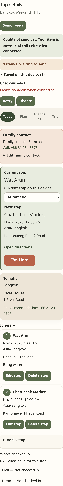

## Activity editor examples

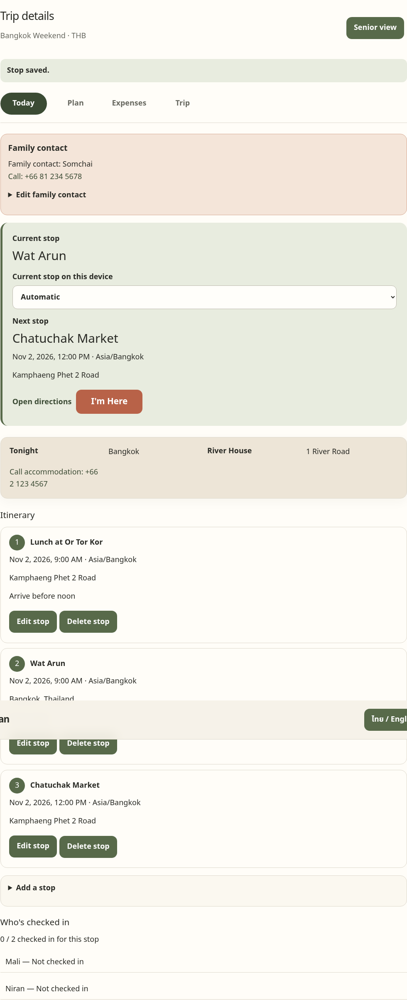

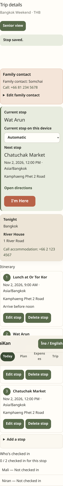

## Plan editors and local activity time

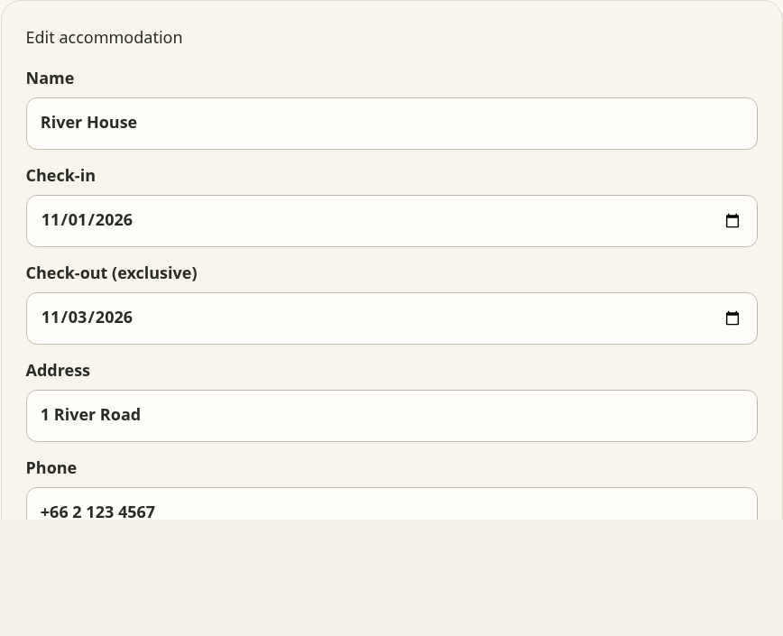

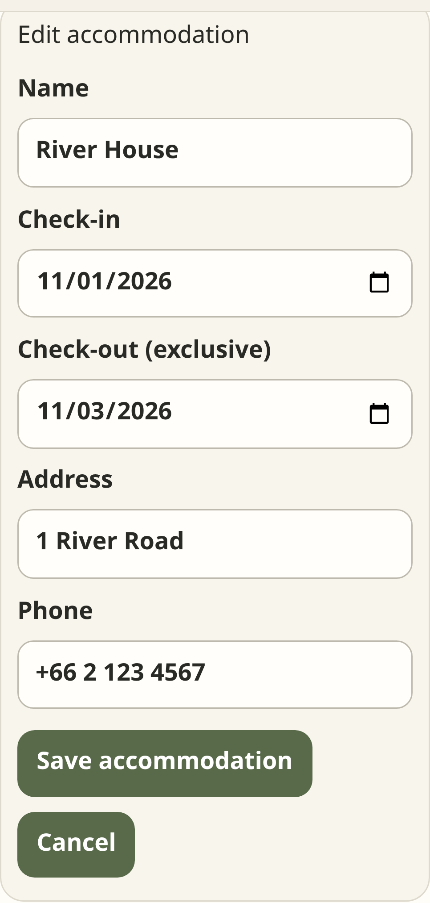

The Plan regressions check that add and edit forms scroll into view, that selecting another night while editing keeps the form usable, and that editing a closed accommodation form saves the same stay ID with its next version. The mobile editor preview shows the saved fields and both actions within the compact layout. The [compact mobile Plan preview](../artifacts/mobile-chromium-plan-fixture-preview.png) shows the tab layout.

Local-time regressions run with an America/Los_Angeles browser and an Asia/Bangkok trip. They cover a legacy Nov 2 UTC timestamp displayed as Nov 1 at 18:00 locally, an unchanged save preserving its original instant, and a newly added local activity edited in Today and Plan. The preview test also checks that Today, Plan, Expenses, and Trip have no horizontal overflow at both viewport sizes.

The complete browser suite passed with 22 desktop and mobile Chromium runs: `npx playwright test e2e/trip-flow.spec.ts`.

## Remaining release verification

The browser fixture does not exercise deployed Supabase Auth or Edge Function networking, rate limiting through the production proxy, real organizer-assisted recovery, multiple real browser profiles, browser storage loss, or installed PWA behavior. Before release, repeat the README manual acceptance steps against a configured Supabase project and test installation, offline recovery, and persisted sessions on physical iOS and Android devices.
